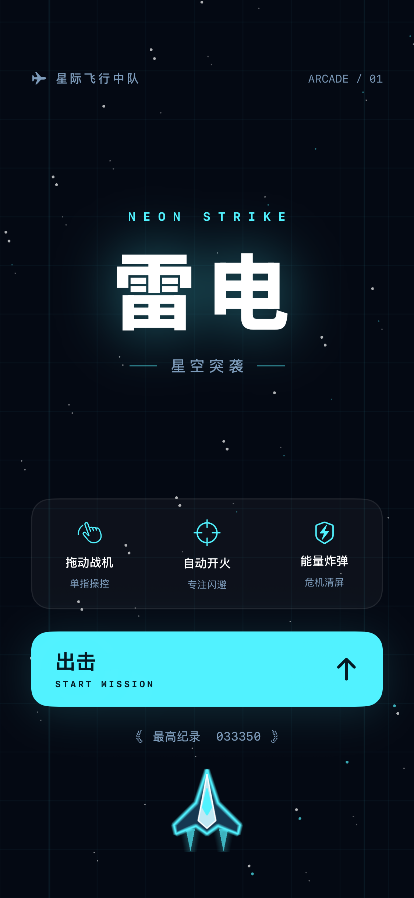

# iPhone Use with Codex

用 **Codex + Xcode + XCTest + devicectl**，在真实 iPhone 上完成「写代码 → 编译签名 → 安装启动 → 看界面 → 点击/拖动/输入 → 验证结果」的完整闭环。

本项目来自一次实际开发：从 SwiftUI Hello World 到《雷电 · 星空突袭》，再到通过 iPhone 界面操作 Lark。提供完整 Xcode 工程、可复用控制脚本、测试和中文教程。无需越狱，无需 Appium / WebDriverAgent；控制脚本只依赖 Python 标准库和 Xcode。



这里的“完整操控”指可观察、可执行、可验证的 UI 操作流程。它不是对 iOS 的无限权限：首次配对、开发者模式、Apple 账户和钥匙串授权需要本人完成，部分受保护页面或 App 可能不支持自动化。跨 App 控制的可用性取决于设备、iOS、Xcode 和目标 App。

## 能做什么

| 工作 | 实现 |
|---|---|
| 生成/修改 SwiftUI App | Codex 编辑工程；可选 Xcode MCP |
| 编译、签名、安装、启动 | `xcodebuild` + `codesign` + `devicectl` |
| 查看界面和截图 | XCTest 可访问性树 + `XCUIScreen` 截图 |
| 点击、拖动、输入文字 | 长运行 XCTest 控制桥，Python 下发 JSON |
| 切换 App、验证前后台 | `XCUIApplication(bundleIdentifier:).activate()` |
| 防止超时误重发 | pending 状态、会话 ID、顺序编号、执行前认领 |
| 回归验证 | 确定性游戏逻辑检查、协议单测、真实 iPhone UI 测试 |

## 10 分钟起步（环境已准备好）

需要 Mac、完整 Xcode（包含 iOS SDK）、Python 3.9+、可用 Codex、数据线连接的 iPhone。原始与本次验证环境见[验证记录](docs/06-validation.md)。最低 App 部署目标是 iOS 17.0，不代表全部控制能力在 iOS 17 / 所有 Xcode 上都验证过。

```bash
git clone https://github.com/InfronAI/iPhone-Use-with-Codex.git
cd iPhone-Use-with-Codex
python3 scripts/iphone.py doctor
python3 scripts/iphone.py devices
cp config.example.json config.local.json
```

编辑 `config.local.json`，填入真实 iPhone 的 UDID、自己的 10 位 Team ID、唯一的 App bundle ID。账户、Team、配对设置见[环境教程](docs/01-setup.md)。该文件不会进入 Git。

```bash
# 无需签名或手机：检查游戏逻辑、编译 App 和 UI 测试
python3 scripts/iphone.py test-engine
python3 scripts/iphone.py build-for-testing

# 需要签名和真机：构建、校验签名、安装、启动
python3 scripts/iphone.py deploy

# 真机点击、拖动、炸弹、暂停、重开、后台恢复测试
python3 scripts/iphone.py test-ui
```

所有构建结果和本地观察数据写入忽略的 `build/`。构建失败查看 CLI 输出的日志路径，不要把 unsigned build 成功当成安装成功。

## 让 Codex 操作 iPhone

先部署示例，再启动控制会话。`--app` 使用你在配置里填写的 bundle ID；也可用 `com.apple.Preferences` 验证系统设置界面。

```bash
python3 scripts/iphone.py prepare-control --app com.yourcompany.codexiphone
# 输出唯一 SESSION 路径，将下面 <SESSION> 替换为该路径

# 终端 A：保持运行
python3 scripts/iphone.py run-control <SESSION>

# 终端 B：等待初始界面可用，再读取输出的 hierarchy-0.txt 和 screen-0.png
python3 scripts/iphone.py collect <SESSION>
python3 scripts/iphone.py action <SESSION> tap-id --identifier startGame
python3 scripts/iphone.py action <SESSION> tap-id --identifier pauseGame
python3 scripts/iphone.py action <SESSION> done
```

每一步返回新的界面树和截图路径，Codex 可以直接读文件、查看图片、决定下一步。`<SESSION>` 是说明占位符，不能原样输入终端。完整命令、中文输入、坐标换算、超时恢复见[真机操控教程](docs/04-device-control.md)。

在仓库目录启动 Codex，然后给它这段任务：

> 阅读 AGENTS.md 和 README。检查当前真实 iPhone 和本地配置，部署示例 App，使用控制桥查看开始界面，点击出击，拖动战机，使用一次炸弹并确认数量减少，再暂停。每步根据最新界面树操作，保存截图证据。发生超时只收集原动作结果，不重复发送动作。最后报告每一步的实际结果。

更多现成任务见[Codex 提示词](docs/07-prompts.md)。

## 教程导航

1. [项目历程：分享讨论、真实执行与关键转折](docs/00-project-history.md)
2. [从零准备 Mac、Xcode、Codex 和 iPhone](docs/01-setup.md)
3. [连接 Xcode MCP，理解 CLI 与 IDE 的关系](docs/02-codex-xcode.md)
4. [从 Hello World 到游戏：构建、签名、部署和测试](docs/03-build-deploy.md)
5. [操控真机：控制桥协议与 Lark 案例](docs/04-device-control.md)
6. [故障排查](docs/05-troubleshooting.md)
7. [验证记录与适用范围](docs/06-validation.md)
8. [可复制的 Codex 提示词](docs/07-prompts.md)
9. [官方资料与来源](docs/08-references.md)

## 项目结构

```text
HelloWorld.xcodeproj/           已共享 scheme 的完整 iPhone 工程
HelloWorld/                    SwiftUI + SpriteKit 游戏、图标资源
HelloWorldUITests/              真机交互回归测试
Tests/GameEngineChecks.swift   无设备、固定种子的战斗规则检查
examples/HelloWorldView.swift  初学者 Hello World 页面
automation/ControlTests.swift  可复用跨 App XCTest 控制桥模板
scripts/iphone.py              部署和交互统一入口（无第三方依赖）
scripts/GenerateAppIcon.swift  程序化图标生成器
Tests/test_control.py         控制协议离线回归测试
docs/                         中文教程与验证记录
config.example.json           本地配置示例
AGENTS.md                     Codex 项目操作约定
```

## 贡献与许可

提交前运行 `python3 -B -m unittest discover -s Tests -v`、`python3 scripts/iphone.py test-engine` 和 `python3 scripts/iphone.py build-for-testing`。[GitHub Actions 模板](docs/ci/checks.yml.example)运行同样的无设备检查。当前推送令牌没有 workflow 权限，因此模板尚未启用；具备权限后将它复制到 `.github/workflows/checks.yml` 即可。云端 CI 不具备你的 Apple 证书和 iPhone，不能代替真机测试。

沿用仓库原有 [MIT License](LICENSE)。示例游戏为教学演示，不含第三方商业游戏素材。
