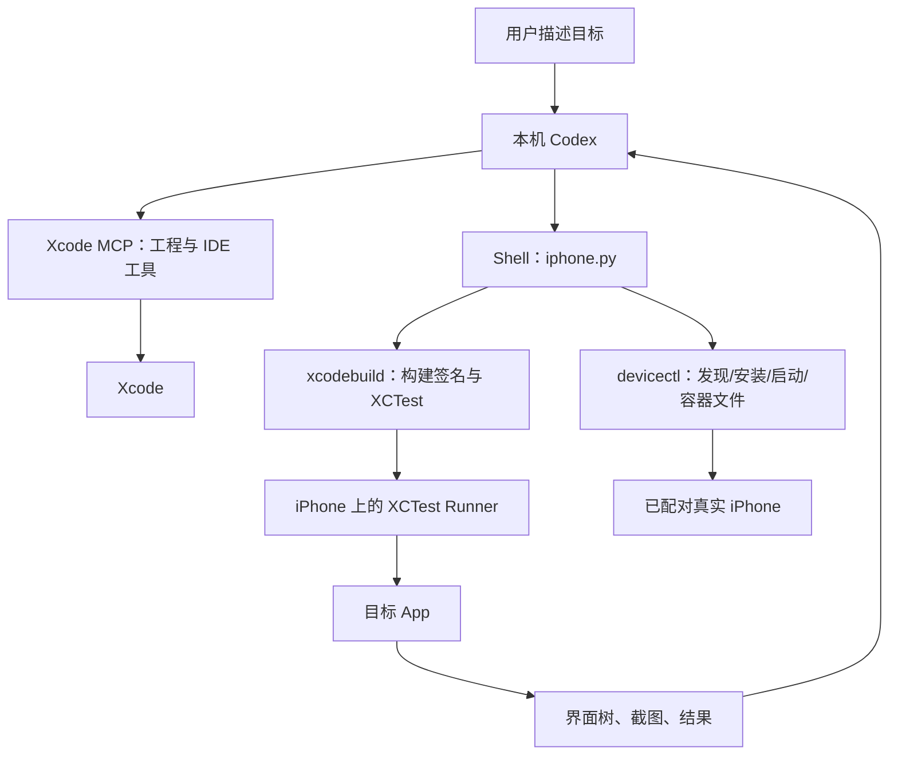

# Codex、Xcode MCP 与命令行

## 三种能力如何组合



外部 Codex 通过 MCP 调用 Xcode，并不意味着把当前 Codex 进程“装进 Xcode”。Xcode 内置 coding agent 与外部 Codex 是不同入口。已有 Codex CLI 配置可以继续用于外部工作流。

## 连接 Xcode MCP

按 [Apple 官方步骤](https://developer.apple.com/documentation/xcode/giving-external-agents-access-to-xcode)，在 Xcode → Settings → Intelligence 中允许外部 agent 使用 Xcode tools，然后在 Xcode 打开工程。

```bash
codex mcp add xcode -- xcrun mcpbridge
codex mcp list
codex mcp get xcode
xcrun --find mcpbridge
```

重新启动需要加载配置的 Codex 会话，然后要求它实际调用发现工具。列表中显示 enabled 只是配置存在，不是连接成功的证据。

本次可见工具包括 `XcodeListWorkspaces`、`XcodeListRunDestinations`、`BuildProject`、`GetBuildLog` 和 `DeviceInteractionStartSession`。历史讨论中的 `XcodeListWindows`、`tabIdentifier` 属于不同接口版本。使用当前工具描述返回的 workspace/session 标识，不能猜测。

## 可选的 Xcode 直接设备交互

当当前 MCP 版本提供设备交互工具时，可按以下次序：

1. 发现工作区及真实设备，确认 active destination。
2. 调用 `DeviceInteractionStartSession` 或 workspace 版本，保存返回的 session key。
3. 调用 `DeviceInteractionSynthesize` 获取最新 hierarchy 和 screenshot；依据最新 hierarchy 定位后执行一步交互。
4. 读取新结果，任务结束调用 `DeviceInteractionEndSession`。

具体参数必须来自当前工具 schema。原始 Lark 任务曾遇到额外授权及工具发现差异，因此仓库同时提供无需该 MCP 交互 API 的 XCTest 控制桥。

## 保留正常权限边界

Codex 的 shell 沙箱可能无法访问 CoreDevice 服务、签名钥匙串或编译插件。实际失败时，应针对必要命令使用当前 Codex 的审批机制，并说明错误。不要把关闭所有审批当作安装步骤。参考 [Codex 权限说明](https://developers.openai.com/codex/security)。

Xcode / iPhone 的授权与 Codex 命令审批是独立的：shell 获准不代表签名账户、设备信任或 Xcode MCP 已授权。
