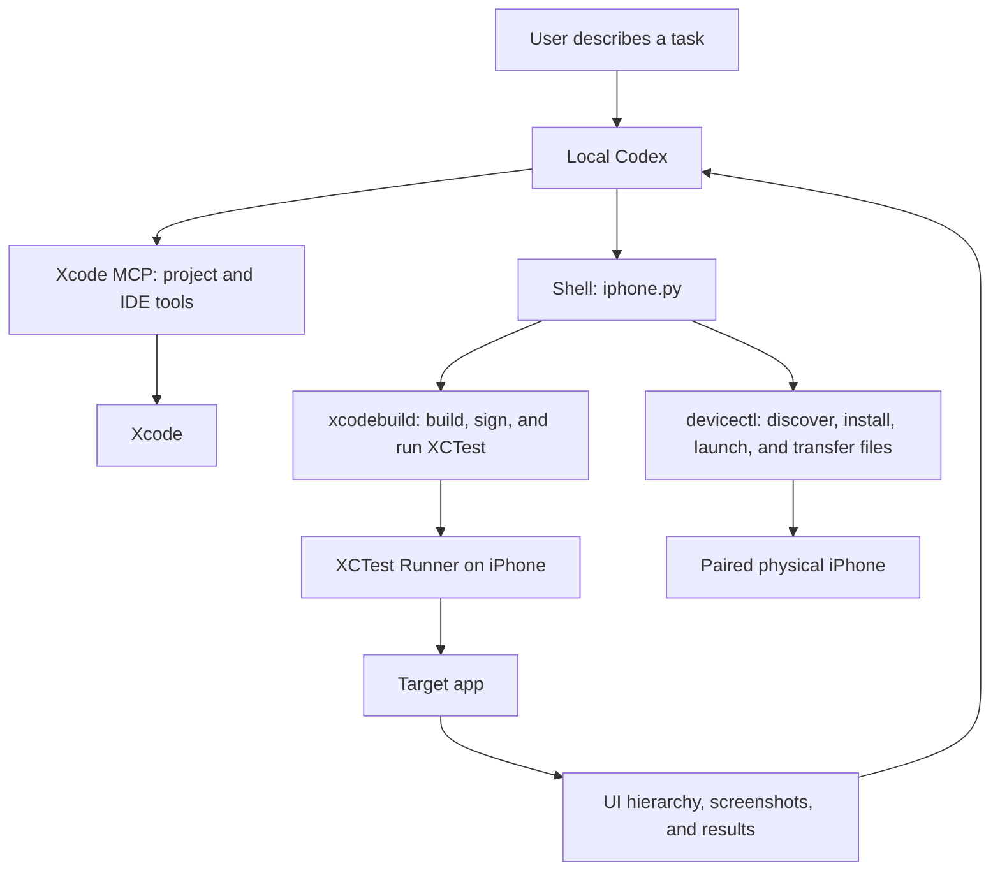

# Codex, Xcode MCP, and the command line

**English** | [简体中文](zh-CN/02-codex-xcode.md) · [Documentation index](README.md)

## How the components fit together



An external Codex client calls Xcode through MCP. This does not install the running Codex process inside Xcode. Xcode's built-in coding agent and external Codex are separate entry points; your existing Codex CLI configuration can continue to serve the external workflow.

## Connect Xcode MCP

Follow [Apple's instructions](https://developer.apple.com/documentation/xcode/giving-external-agents-access-to-xcode): allow external agents to use Xcode tools under Xcode → Settings → Intelligence, then open the project in Xcode.

```bash
codex mcp add xcode -- xcrun mcpbridge
codex mcp list
codex mcp get xcode
xcrun --find mcpbridge
```

Restart any Codex session that needs to load the configuration, then ask it to call the discovery tool. An **enabled** entry proves that configuration exists, not that the connection works.

Tools available during this project included `XcodeListWorkspaces`, `XcodeListRunDestinations`, `BuildProject`, `GetBuildLog`, and `DeviceInteractionStartSession`. The historical discussion's `XcodeListWindows` and `tabIdentifier` belong to a different interface version. Use workspace and session identifiers returned by the current tools rather than guessing them.

## Optional direct device interaction through Xcode

If the current MCP version exposes device-interaction tools:

1. Discover the workspace and physical device, and verify the active destination.
2. Call `DeviceInteractionStartSession` or its workspace variant, and keep the returned session key.
3. Call `DeviceInteractionSynthesize` to obtain the latest hierarchy and screenshot. Locate the target in that hierarchy, then execute one interaction.
4. Inspect the new result and call `DeviceInteractionEndSession` when finished.

Read argument names from the current tool schema. The original Lark task encountered additional authorization and device-discovery differences, which is why the repository also includes an XCTest bridge independent of this MCP interaction API.

## Respect the permission boundaries

A Codex shell sandbox may be unable to reach CoreDevice services, the signing keychain, or compiler plugins. If a necessary command fails for that reason, use the approval mechanism provided by the current Codex environment and explain the error. Disabling all approvals is not a setup step. See the [Codex permissions documentation](https://developers.openai.com/codex/security).

Xcode/iPhone authorization and Codex command approval are separate. Permission to run a shell command does not authorize a signing account, establish device trust, or grant Xcode MCP access.
