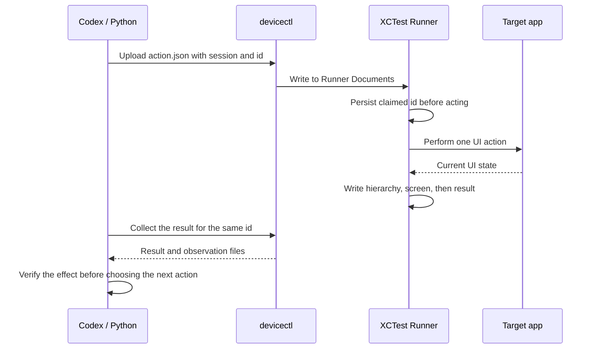

# Control a physical iPhone: observe, act, and verify

**English** | [简体中文](zh-CN/04-device-control.md) · [Documentation index](README.md)

For exact commands for your first two-terminal session, start with [the first-run walkthrough](09-first-run.md).

## Design

Codex issues commands on the Mac. A signed XCTest Runner calls public UI automation APIs on the physical iPhone. `devicectl device copy` transfers commands and observations through our test Runner's container; it does not read the target app's private file database.



## Start a session

Complete the [setup guide](01-setup.md) and confirm that `config.local.json` specifies the physical phone and your signing identity. Run `python3 scripts/iphone.py apps` to find the target app's actual bundle ID. Do not assume that Feishu and Lark share an ID based on their display names.

```bash
python3 scripts/iphone.py prepare-control --app com.apple.Preferences
```

The command creates a unique directory such as `build/control/012345...`. Assign the actual printed path to a variable in your terminal:

```bash
SESSION='build/control/REPLACE_WITH_THE_PRINTED_SESSION_ID'
python3 scripts/iphone.py run-control "$SESSION"
```

Leave terminal A running. Logs go to `SESSION/runner.log`. This signs and installs the test Runner and may also build/install its sample host app, so valid signing is required. It operates the existing target app named by `--app`; it does not install that third-party app.

In terminal B, set the same SESSION value, then run:

```bash
python3 scripts/iphone.py collect "$SESSION"
```

The initial result has ID 0. Read `hierarchy-0.txt` and inspect `screen-0.png`. The first launch may take time for signing and Runner startup. Collection waits up to 240 seconds by default; use `--timeout 420` to allow more time.

Each session builds an isolated project under `build/control/`, leaving the original game UI tests intact. On the phone, results live in `Documents/codex-<session>/`.

## Common actions

| Intent | Command after `python3 scripts/iphone.py` |
|---|---|
| Get a new observation | `action "$SESSION" snapshot` |
| Tap by stable ID | `action "$SESSION" tap-id --identifier startGame` |
| Tap coordinates | `action "$SESSION" tap --x X --y Y` |
| Drag or swipe between points | `action "$SESSION" drag --x X1 --y Y1 --end-x X2 --end-y Y2` |
| Type into the current focus | `action "$SESSION" type --text '你好，Codex'` |
| Switch apps | `action "$SESSION" activate --bundle com.apple.Preferences` |
| Issue a Home event | `action "$SESSION" home` |
| Finish | `action "$SESSION" done` |
| Collect the original action's result | `collect "$SESSION" --timeout 240` |

X/Y are placeholders. Locate elements in the latest hierarchy before each action. Coordinates are **points** within the app frame. On the original device, screenshots were 1125×2436 pixels while UI coordinates were 375×812 points. Do not use screenshot pixels directly as tap coordinates. Observe again on a different device or after an orientation change rather than reusing historical coordinates.

`tap-id` requires exactly one matching, hittable element; otherwise it stops. Before typing, tap the intended input field and confirm focus. Chinese input can still depend on the keyboard, focus, and target app, so inspect the actual draft.

The hierarchy and screenshot are captured sequentially, not as an atomic snapshot. App-switch animations can produce a transitional image; request another snapshot to confirm a stable layout. A game may end while you read the previous observation, making its pause button disappear. Observe again and select a currently available control. An explicit Runner error terminates the test; inspect the error and current screen before preparing a new session.

A successful Home event does not prove that the app entered the background. It failed to do so on the original project device. Verify the app state or switch to Settings and back when testing lifecycle behavior.

## Timeouts and avoiding repeated execution

Each client allows one pending action at a time and uses a file lock to prevent concurrent writes. Pending state is persisted before upload; the Runner writes the claimed ID before execution. Sessions have separate UUIDs so old commands do not enter a new session. Completion is written last, after the observation files have been generated.

These measures provide conservative **at-most-once attempt** semantics, not a transaction or an exactly-once guarantee. Power loss, an XCTest crash, or a transfer failure may leave an action unexecuted, or executed without a complete acknowledgement.

If an action times out:

1. Keep the current session and pending ID.
2. Inspect `runner.log`. You can independently observe the phone with `python3 scripts/iphone.py screenshot build/current.png` if the local devicectl supports that subcommand.
3. Run **collect on the original session**. It retrieves results without resending the action.
4. Do not issue another action before resolving the outcome, especially another tap on Send, Pay, or Delete.
5. If the process has died and the result cannot be recovered, establish the current state manually or through independent observation before preparing a new session. Do not clear pending state and blindly replay the action.

The session loop expires after 30 minutes, although individual XCTest calls may be delayed by system waits. `run-control` sets a 2100-second test execution allowance; exact termination timing depends on XCTest. Send done when finished and wait for terminal A to exit. Run only one control or test session on a phone at a time.

## Adapt the historical Lark workflow

In the original task, the user explicitly requested a message to a specified contact and authorized a simple greeting. The execution found the conversation, verified the recipient, entered and checked the draft, sent it, and observed the result. This tutorial does not include a replay script containing private contacts.

To adapt the workflow:

1. Confirm the app bundle ID for a signed-in test account or another account you are authorized to operate, then prepare a session.
2. Inspect the conversation list or search results. Use the name and other visible details to identify a unique recipient. Ask the user if names are ambiguous.
3. Open the conversation and inspect the composer and keyboard. Focus the field, then enter the authorized content.
4. Inspect the new hierarchy and screenshot to confirm the draft and Send button state.
5. Tap Send once. If the action times out, keep collecting rather than tapping again.
6. Evaluate the message bubble, cleared draft, and status icon together. UI evidence alone does not establish a server-side audit or prove that the recipient read the message.
7. Finish with done and handle sensitive local logs before sharing evidence.

Do not automatically replay messages to historical contacts. The repository's automated regression tests operate only the sample game and Settings.

## Scope and limits

The bridge supports UI accessible through public XCTest APIs. It cannot guarantee access to every third-party app, protected system screen, biometric prompt, lock screen, payment authentication flow, or screen that prevents automation. Hierarchies may omit text rendered by custom controls; combine screenshots and the visible structure rather than inventing elements.

Screenshots, hierarchies, and action JSON files default to the ignored build directory. They may contain typed text, account details, and chats. After a session has ended, remove its local directory if you need to clear those records. To remove observations from the phone, you can uninstall the dedicated test Runner once no other test uses it. Its ID is `<bundle_id>.uitests.xctrunner`; do not accidentally uninstall the target app.
