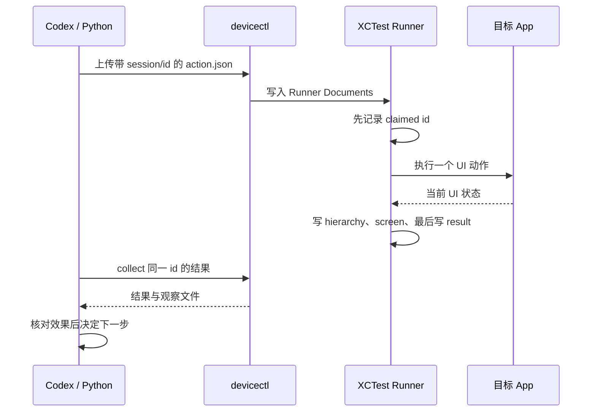

# 真机交互控制：看到、操作、验证

## 设计

Codex 在 Mac 上发出命令；已签名的 XCTest Runner 在真实 iPhone 上调用公开的 UI 自动化 API。`devicectl device copy` 只在我们自己的测试 Runner 容器里传递命令和观察结果，不读取目标 App 的私人文件数据库。



## 开始一个会话

完成[环境配置](01-setup.md)，确认 `config.local.json` 指向真实手机和自己的签名。用 `python3 scripts/iphone.py apps` 查看目标 App 的实际 bundle ID；飞书和 Lark 不能仅凭显示名假定为同一个 ID。

```bash
python3 scripts/iphone.py prepare-control --app com.apple.Preferences
```

命令产生唯一目录，例如 `build/control/012345...`。将实际输出路径设为本终端变量：

```bash
SESSION='build/control/这里替换为实际输出的会话ID'
python3 scripts/iphone.py run-control "$SESSION"
```

终端 A 保持运行，日志写入 `SESSION/runner.log`。该过程会签名并安装测试 Runner，也可能构建/安装其宿主示例 App；需有可用签名。操作的是 `--app` 指定的已有目标 App，不会安装该第三方 App。

终端 B 设置同一个 SESSION，然后：

```bash
python3 scripts/iphone.py collect "$SESSION"
```

初始结果为 0。阅读 `hierarchy-0.txt`，查看 `screen-0.png`。第一次启动需等待签名和 runner 就绪；默认收集超时为 240 秒，可用 `--timeout 420` 增加等待。

每个会话在 `build/control/` 拥有隔离工程，不改写原来的游戏 UI 测试。手机中的结果目录是 `Documents/codex-<session>/`。

## 常用操作

| 意图 | 命令（前缀为 `python3 scripts/iphone.py`） |
|---|---|
| 新观察 | `action "$SESSION" snapshot` |
| 按稳定 ID 点击 | `action "$SESSION" tap-id --identifier startGame` |
| 按坐标点击 | `action "$SESSION" tap --x X --y Y` |
| 拖动 / 定向滑动 | `action "$SESSION" drag --x X1 --y Y1 --end-x X2 --end-y Y2` |
| 向当前焦点输入 | `action "$SESSION" type --text '你好，Codex'` |
| 切换 App | `action "$SESSION" activate --bundle com.apple.Preferences` |
| 发出 Home 事件 | `action "$SESSION" home` |
| 结束 | `action "$SESSION" done` |
| 收集原动作结果 | `collect "$SESSION" --timeout 240` |

X/Y 为说明占位符。每次先从最新 hierarchy 获取元素位置，坐标为 app frame 内的 **points**。例如历史设备屏幕截图为 1125×2436 像素，UI 坐标为 375×812 points，不能直接把截图像素作为点击坐标。新设备或横竖屏变化后要重新观察，不复用历史坐标。

`tap-id` 要求恰好一个匹配且可点击的元素，否则停止。文字输入之前先点击目标输入框并检查焦点；中文输入仍可能受键盘、焦点和目标 App 影响，需要检查实际草稿。

界面树和截图按顺序采集，并非同一时刻的原子快照。App 切换动画期间可能看到过渡画面，应再 snapshot 确认稳定布局。游戏可能在阅读结果时已经结束；旧树里的暂停按钮会消失，此时应重新观察并选择当前按钮，不能假设原按钮仍可点击。明确的 Runner error 会终止该测试；先检查错误和当前画面，再准备新会话。

Home 事件成功返回不证明 App 已进入后台。在本项目原始设备上它曾无效；生命周期验证应检查 App 状态，或切换到设置后再返回。

## 超时与不重复执行

每个客户端一次只允许一个 pending 动作，并用文件锁阻止并发写入。上传前持久化 pending；Runner 在执行前写入 claimed 编号。不同会话有不同 UUID，旧命令不会混入新会话。完成状态最后写入，保证确认结果存在时观察文件已生成。

这些措施提供保守的**至多一次尝试**语义，不是事务或“恰好一次”保证。断电、XCTest 崩溃或传输错误可能导致动作未执行，或已执行但没有完整回执。

遇到超时：

1. 保留当前会话和 pending 编号。
2. 检查 `runner.log`；可用 `python3 scripts/iphone.py screenshot build/current.png` 独立观察当前手机画面（截图子命令依赖本机 devicectl 是否支持）。
3. 执行 **collect 原会话**，它只取结果，不重传动作。
4. 未确认结果前不要再发动作；尤其不要重复点击发送、支付、删除等按钮。
5. 若进程已死且结果无法恢复，人工或独立观察确认当前状态，再准备全新会话；不要手动清除 pending 后盲目重放。

会话在 30 分钟循环期限后停止；单个 XCTest 调用仍可能被系统等待延迟。run-control 设置了 2100 秒的测试执行上限，实际中止时机取决于 XCTest。结束时发送 done 并等待终端 A 退出。一个手机只运行一个控制/测试会话。

## Lark 历史案例如何复用

原始任务中用户明确要求给指定联系人发消息，并允许使用简单招呼；真实执行完成了查找会话、核对收件人、输入、核对草稿、发送和结果观察。教程不提供含私人联系人的回放脚本。

复用步骤：

1. 在已登录的测试账号/获授权账号上确认目标 App bundle ID，准备控制会话。
2. 读取会话列表或搜索结果，依据姓名及其他可见信息确认唯一收件人。遇同名且无法区分时询问用户。
3. 打开会话，观察输入框与当前键盘。先聚焦，再输入已授权内容。
4. 读取新的 UI 树和截图，确认草稿内容及发送按钮状态。
5. 单次点击发送；如果操作超时，继续 collect，不再次点击。
6. 结合新消息气泡、草稿清空和状态图标判断界面反馈。仅据 UI 不应宣称服务端审计通过或收件人已读。
7. done 结束，处理好本地敏感日志后再分享任何证据。

不要对历史联系人或旧消息自动重放。本项目的自动回归测试只操作示例游戏和系统设置。

## 能力边界

支持公开 XCTest 能操作的 UI。不可保证所有第三方 App、系统保护页面、生物认证、锁屏、支付认证或反自动化页面都可操作。界面树可能缺少自绘控件文字；这时结合截图和当前可见结构验证，不能编造元素。

所有截图、UI 树、动作 JSON 默认在忽略的 build 目录中。它们可能含输入文本、账户和聊天内容。需要清理时，在确认会话结束后删除自己需要清理的本地会话目录；若要删除手机上的观察文件，可在确认没有其他测试使用时卸载专用测试 Runner。它的 ID 是 `<bundle_id>.uitests.xctrunner`，不要误卸载目标 App。
